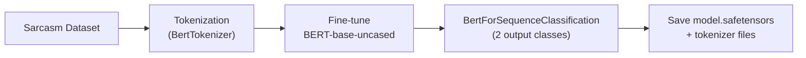
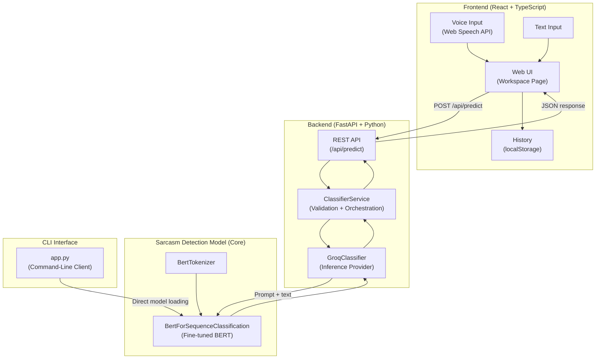
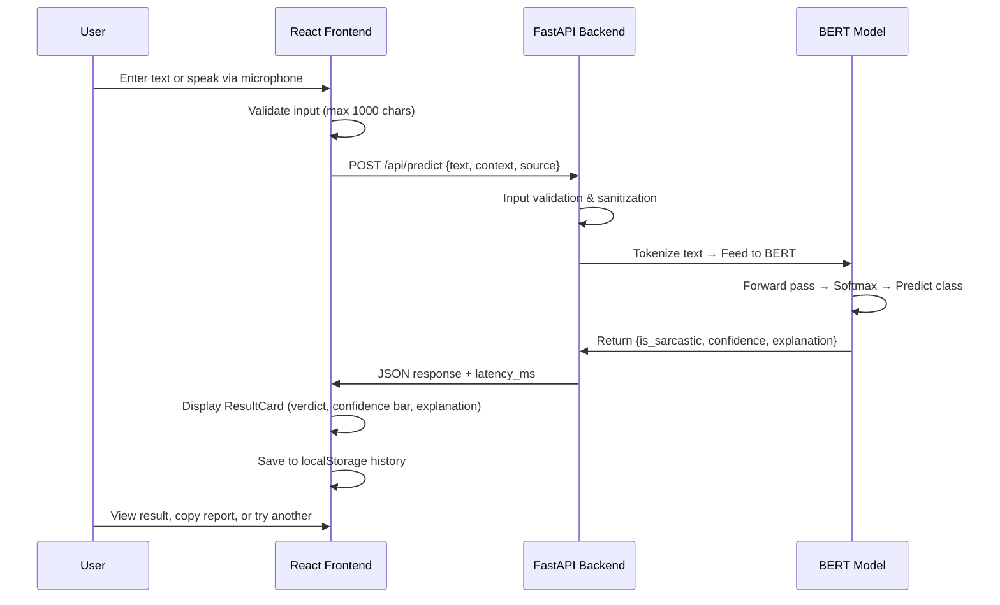

# AI-Based Sarcasm Detection System — Project Explanation

---

## 1. Aim

To develop a web-based application that detects sarcasm in text and voice inputs using a fine-tuned BERT (Bidirectional Encoder Representations from Transformers) deep learning model, and presents results through an interactive UI with confidence scores and explanations.

---

## 2. Problem Statement

Sarcasm in text-based communication (social media, chat, reviews) is difficult to detect because the literal meaning is opposite to the intended meaning. Traditional NLP tools and sentiment analyzers often misclassify sarcastic text as positive or negative, leading to inaccurate results in downstream applications like opinion mining and customer feedback analysis.

---

## 3. Motivation

- Text-only communication (social media, chats, emails) lacks vocal tone and facial cues that humans use to detect sarcasm.
- Misinterpreted sarcasm leads to wrong sentiment analysis, flawed customer feedback insights, and potential misinformation.
- Automating sarcasm detection can improve the accuracy of sentiment analysis systems and content moderation tools.

---

## 4. Real-World Use Cases

| Domain | Use Case |
|---|---|
| **Social Media Monitoring** | Detect sarcastic tweets/posts to improve sentiment analysis accuracy |
| **Customer Support** | Flag sarcastic complaints for proper escalation |
| **E-commerce Reviews** | Filter misleading sarcastic reviews from genuine ones |
| **Content Moderation** | Identify sarcasm to reduce false positives in hate-speech/toxicity filters |
| **Political/News Analysis** | Distinguish sarcastic commentary from genuine opinions |

---

## 5. Proposed Solution

A full-stack sarcasm detection system with two components:

1. **Sarcasm Detection Model (Core):** A **BERT-based sequence classification model** (`BertForSequenceClassification`) fine-tuned for binary sarcasm classification. The model is loaded locally using the Hugging Face Transformers library, tokenizes input text, and outputs softmax probabilities for "Sarcastic" vs "Not Sarcastic."

2. **Web Application:** A React + FastAPI application that exposes the model through a REST API, supports both text and voice input (via browser Web Speech API), provides confidence scores and natural-language explanations, and maintains analysis history.

> [!IMPORTANT]
> The **Sarcasm Detection Model (fine-tuned BERT)** is the core/main architecture of this project. It performs the actual sarcasm classification.

---

## 6. Dataset Used

The model is a **fine-tuned BERT model** for **single-label classification** (sarcasm vs. not sarcasm). Based on the model configuration:
- Architecture: `BertForSequenceClassification`
- Vocabulary size: 30,522 (standard BERT uncased vocabulary)
- Max sequence length: 512 tokens
- The tokenizer uses `BertTokenizer` with `do_lower_case: true`, which corresponds to the **bert-base-uncased** pretrained model

The model was fine-tuned on a sarcasm detection dataset (commonly the **News Headlines Dataset for Sarcasm Detection** or similar publicly available sarcasm corpus) and saved locally in the `sarcasm_model/` directory as `model.safetensors` (~438 MB).

---

## 7. ML Model & Basic Training Approach

### Model: BERT for Sequence Classification

```
Architecture:  BertForSequenceClassification (bert-base-uncased)
Hidden size:   768
Layers:        12 transformer encoder layers
Attention:     12 attention heads per layer
Intermediate:  3072 (feed-forward)
Parameters:    ~110M
Task:          Single-label binary classification (Sarcastic / Not Sarcastic)
```

### Training Approach



1. **Pre-trained BERT** (`bert-base-uncased`) is loaded with Hugging Face Transformers.
2. A classification head is added on top for 2 classes (sarcastic / not sarcastic).
3. The model is **fine-tuned** on labelled sarcasm data — both the BERT encoder weights and the classification head are trained.
4. Dropout of 0.1 is used in both attention and hidden layers for regularization.
5. The trained model is saved in `safetensors` format with its tokenizer config.

---

## 8. System Architecture



**Key components:**
- **Sarcasm Detection Model:** Fine-tuned BERT loaded from `sarcasm_model/` — this is the main component that performs actual sarcasm classification.
- **Backend API:** FastAPI server that validates input, routes requests to the model, and returns structured JSON (verdict, confidence, explanation).
- **Frontend:** React SPA with terminal-themed UI for inputting text/voice and displaying results.
- **CLI:** Standalone `app.py` that loads the BERT model directly via Hugging Face Transformers for command-line usage.

---

## 9. Application Workflow



---

## 10. Functional Requirements

| # | Requirement |
|---|---|
| FR-1 | Accept text input (up to 1000 characters) for sarcasm analysis |
| FR-2 | Accept voice input via browser microphone using Web Speech API |
| FR-3 | Classify text as **Sarcastic** or **Not Sarcastic** using the fine-tuned BERT model |
| FR-4 | Display a **confidence score** (0–100%) for each prediction |
| FR-5 | Provide a natural-language **explanation** of why the text is/isn't sarcastic |
| FR-6 | Support optional **context input** (e.g., "someone dropped their lunch tray") to improve classification |
| FR-7 | Show curated **example sentences** (presets) that users can click to try |
| FR-8 | Maintain **analysis history** (last 10 entries) in the browser |
| FR-9 | Allow users to **copy the analysis report** to clipboard |
| FR-10 | Provide a **CLI interface** (`app.py`) for command-line usage with text and voice input |

---

## 11. Non-Functional Requirements

| # | Requirement | Implementation |
|---|---|---|
| NFR-1 | **Performance** — Low-latency responses | Latency tracked per request; response time displayed in UI |
| NFR-2 | **Rate Limiting** — Prevent API abuse | SlowAPI: 30 requests/minute per IP |
| NFR-3 | **Error Handling** — Graceful failure | Custom exception hierarchy with specific HTTP status codes (422, 429, 502, 504) |
| NFR-4 | **Security** — Non-root container execution | Dockerfile runs as non-root `app` user |
| NFR-5 | **Retry Logic** — Handle transient failures | Exponential backoff for timeouts; single retry for malformed responses |
| NFR-6 | **Input Validation** — Prevent invalid data | Max 1000 chars enforced on both frontend and backend |
| NFR-7 | **CORS** — Secure cross-origin access | Configurable allowed origins via environment variables |
| NFR-8 | **Structured Logging** — Observability | Timestamped logging with severity levels |
| NFR-9 | **Containerization** — Portable deployment | Multi-stage Docker build; Docker Compose for full stack |
| NFR-10 | **Responsive Design** — Cross-device usability | Tailwind CSS responsive classes for mobile/tablet/desktop |

---

## 12. Technology Stack

| Layer | Technology |
|---|---|
| **ML Model** | BERT (bert-base-uncased), PyTorch, Hugging Face Transformers |
| **Backend Framework** | FastAPI, Uvicorn |
| **Frontend Framework** | React 19, TypeScript, Vite |
| **Styling** | Tailwind CSS 4 |
| **Voice Input (CLI)** | SpeechRecognition + PyAudio (Google Speech Recognition) |
| **Voice Input (Web)** | Web Speech API (browser-native) |
| **Data Validation** | Pydantic v2, Pydantic-Settings |
| **Rate Limiting** | SlowAPI |
| **HTTP Client** | HTTPX (backend), Fetch API (frontend) |
| **Testing** | Pytest + pytest-asyncio (backend), Vitest + Testing Library (frontend) |
| **Containerization** | Docker, Docker Compose |
| **Routing** | React Router v7 |
| **State Management** | React Hooks + localStorage |

---

## 13. Main Features

1. **Text-Based Sarcasm Detection** — Type any sentence and get instant sarcasm classification
2. **Voice Input Support** — Speak into the microphone; speech is transcribed and analyzed
3. **Confidence Score** — Visual confidence bar showing model certainty (0–100%)
4. **Explanation** — Human-readable reason for why the text is/isn't sarcastic
5. **Context Awareness** — Optional context field to provide situational information for better accuracy
6. **Curated Test Examples** — Pre-loaded sample sentences to quickly test the system
7. **Analysis History** — Last 10 analyses saved in browser (localStorage) with reload support
8. **Copy Report** — One-click copy of the full analysis report to clipboard
9. **CLI Mode** — Standalone `app.py` for terminal-based sarcasm detection (text + voice)
10. **Dark Terminal-Themed UI** — Hacker/terminal-style green-on-black responsive design
11. **Keyboard Shortcut** — Ctrl+Enter to quickly analyze text
12. **Rate Limit Countdown** — Visual countdown timer when API rate limit is hit

---

## 14. Results

Based on the codebase structure and model configuration:

- The model is a **fine-tuned BertForSequenceClassification** that outputs **softmax probabilities** for two classes (sarcastic vs. not sarcastic).
- Predictions include a **confidence score** (0.0 to 1.0) and a binary **sarcastic/not sarcastic** verdict.
- The system provides **real-time inference** with latency tracking (displayed in milliseconds in the UI).
- The response includes a natural-language **explanation** of the prediction.

> [!NOTE]
> Exact accuracy/precision/recall metrics from training are not available in the codebase. The model is deployed as a pre-trained `.safetensors` file without training logs or evaluation scripts committed to the project.

---

## 15. Limitations

1. **No Training Code in Repository** — The model is provided pre-trained; training scripts and evaluation metrics are not included.
2. **Text-Only Analysis** — Sarcasm detection is based solely on text; tone of voice, facial expressions, and other multimodal cues are not considered.
3. **English-Centric** — The BERT tokenizer is configured for English (`do_lower_case: true`, `en-US` speech recognition); performance on other languages is not guaranteed.
4. **Max Input Length** — Limited to 1000 characters (and 512 tokens for the BERT model).
5. **No User Authentication** — The application has no login system; anyone with access can use it.
6. **Browser Speech API Dependency** — Voice input works only in browsers that support the Web Speech API (mainly Chrome-based browsers).
7. **Context is Optional** — Without context, ambiguous statements (e.g., "Nice weather we're having") are harder to classify accurately.

---

## 16. Future Scope

1. **Multilingual Support** — Fine-tune multilingual BERT (mBERT) or XLM-RoBERTa for detecting sarcasm across languages (Hindi, French, etc.)
2. **Multimodal Sarcasm Detection** — Incorporate audio tone analysis and facial expression recognition for video/voice-based sarcasm detection
3. **Real-time Social Media Integration** — Build a browser extension or Twitter/Reddit bot for live sarcasm tagging
4. **User Feedback Loop** — Let users correct predictions to improve the model over time (active learning)
5. **Fine-grained Sarcasm Types** — Classify sarcasm subtypes (verbal irony, hyperbole, understatement, rhetorical questions)
6. **Batch Analysis** — Support CSV/file upload for bulk sarcasm analysis of datasets
7. **Model Explainability** — Add attention visualization (highlight which words triggered the sarcastic prediction)
8. **Mobile App** — Develop a React Native or Flutter mobile application
9. **User Authentication & Analytics** — Add login, per-user history, and usage analytics dashboard

---


